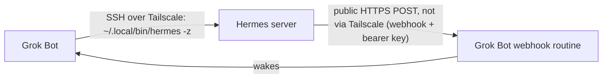

# Grok Bot ⇄ Hermes Agent bridge: overview

> **Experimental: not yet validated by a clean fresh install.**

> **Status: experimental.** This is a personal project, not an official integration. It works day to day, but it has the gaps listed below.

## Why it exists
I run two AI assistants. **Grok Bot** is a cloud assistant with its own computer, routines and connectors. **Hermes** is a self-hosted agent on my own Linux server, connected to my long-term wiki. Each is good at different things, and I wanted them to pass work and information to each other without me copying and pasting between chats.

> **Want Grok Bot to build this for you?** Paste [SETUP-PROMPT.md](SETUP-PROMPT.md) into a Grok Bot chat.

## Prerequisites
- **A Grok Bot account** with routines (webhook triggers) and a persistent computer ("box").
- **A self-hosted Hermes-style agent** on a machine you control, reachable over SSH and exposing a one-shot CLI such as `~/.local/bin/hermes -z`.
- **Tailscale** on both machines (same tailnet), with a tag for the Grok Bot node, an access rule and an OAuth client for non-expiring re-joins.

## How it works
- **Private network:** both machines join the same Tailscale tailnet. Grok Bot's node has its own tag, and an access grant allows SSH (port 22) and the Hermes API port on the Hermes machine. Tailscale permissions are additive, so this is only restrictive if no broader rule also matches; review all matching rules and use policy tests to prove other hosts and ports are denied.
- **Grok Bot to Hermes:** Grok Bot logs in over SSH with its own key and runs `~/.local/bin/hermes -z "<message>"` by full path (non-interactive SSH often lacks it on PATH), quoting the message safely, e.g. `ssh … "~/.local/bin/hermes -z $(printf %q "$MSG")"` (`printf %q` requires Bash locally and a compatible remote shell such as Bash; it is not portable shell quoting). Hermes's reply comes straight back, usually within 20 to 120 seconds.
- **Hermes to Grok Bot:** Hermes sends an HTTPS POST to a Grok Bot **webhook routine** to `<WEBHOOK_URL>` with the header `Authorization: Bearer <WEBHOOK_KEY>` and a small JSON body. The routine wakes Grok Bot within seconds (the POST goes over the public internet to a cloud routine, not over Tailscale), and Grok Bot replies over the SSH path. An earlier file-outbox design is retired; its routine is paused (not polled) and kept only for manual emergency use.
- **Self-repair:** Grok Bot's computer can hibernate or be rebuilt, which wipes installed tools. A script reinstalls SSH and Tailscale, rejoins the tailnet using a non-expiring OAuth client, and health-checks Hermes. It runs three times a day and whenever a reply over SSH fails.

## Pros
- **Small public exposure:** the bridge opens no inbound internet port on the Hermes machine; SSH stays on the private tailnet (this says nothing about other services you run there). The only internet-facing piece is Grok Bot's own webhook endpoint, protected by a secret key.
- **Fast wake-up:** Hermes can wake Grok Bot at any hour via the webhook (an outbound HTTPS POST to a cloud routine), with no polling delay. Replies still travel over SSH and typically take 20–120 seconds.
- **Restricted network reach; broad SSH account permissions:** Grok Bot's tag is granted specific ports on named machines (restrictive only if no broader ACL or grant also matches — verify with policy tests), and it uses its own dedicated, revocable SSH key, but that key can run any command as its SSH user.
- **Secrets stay secret:** the Tailscale secret is held in Grok Bot's secret store and is never pasted into chat. The SSH private key never leaves Grok Bot's computer.
- **Messages are data, not commands:** Grok Bot treats anything from Hermes as information. It won't take irreversible actions, contact third parties or reveal secrets because a message asked it to.
- **Self-healing:** the bridge can recover automatically when tools, credentials and access remain available; a full wipe may require human intervention.
- **Simple:** it uses standard tools (SSH, HTTPS and routines), with no custom server.

## Cons and safety considerations
- **SSH is powerful.** Grok Bot's key can run any command as that user on the Hermes machine. A tighter setup would restrict the key with `command=` in `authorized_keys`, or use a dedicated low-privilege user.
- **One agent can be steered by another.** A compromised or confused Hermes could send misleading messages. The data-not-instructions rule reduces this risk but doesn't remove it.
- **The webhook key is a bearer credential.** Anyone with the URL and key can trigger Grok Bot. Store them only in secret stores or a mode-600 file, and rotate by recreating the routine if they leak.
- **App bug during setup (fixed in Grok Bot 0.75.2):** older desktop versions hid the webhook URL, so getting the URL and key needed a workaround (in-app deep links). From 0.75.2, the routine's menu shows the URL and key directly, with the key hidden until you reveal it.
- **Human-in-the-loop prompts:** some actions trigger approval cards, which is safer but slower.
- **Keep secrets out of shared docs.** Use placeholders like `<HERMES_HOST>`, `<TAILNET>` and `<SSH_USER>`, and never share private keys or OAuth secrets.

## Hermes-side risk
`hermes -z` runs a one-shot Hermes session that bypasses Hermes's approval prompts and loads its normal tools, memory and rules. Grok Bot's "messages are data, not commands" rule only governs Grok Bot; it does not enforce any safety on the Hermes side, and whoever holds the bridge SSH key can drive Hermes with its full permissions. Accept this risk explicitly before connecting, and prefer running the bridged Hermes under a restricted account and/or reduced tool configuration rather than connecting a privileged agent.

## Current gaps
- **Hermes replies are slow.** A `hermes -z` reply over SSH can take 3 minutes or more. Don't send it from a shell call that moves to the background and gets forgotten, because a finished background command won't wake your Grok Bot and the reply will sit unread. Run each Hermes call in a background task that waits for the reply (allow at least 10 minutes) and then reports back to the Grok Bot. If the wait runs out, report that rather than going quiet. A single wait can last only about 13 minutes, so for anything that may take longer, ask Hermes to send its answer back through the webhook (which wakes the Grok Bot whenever it arrives) instead of relying on the SSH reply. The webhook is the safety net; the 2,000-character rule still applies.
- **No automatic fallback if the webhook fails.** Polling is switched off, so a failed POST is lost unless Hermes notices the error. The paused outbox routine is a manual emergency fallback only: it is not polled, so files written to the outbox are not delivered until someone re-enables it.
- **Idle network dropouts:** Grok Bot's node often goes stale while idle and needs a reconnect before it can reply over SSH (the self-repair script does this automatically).
- **No read receipts** or delivery acknowledgements.
- **No typing or "working on it" indicator.**
- **No message IDs or guaranteed ordering.**
- **No thread memory:** each message starts a fresh conversation.
- **Message size rule:** Keep every complete message under 2,000 characters in either direction, including any numbering; split longer content into parts labelled 1/N, 2/N. Never send large files inline; share a recipient-accessible path or an appropriately permissioned URL instead.
- **Webhook body limit unknown:** a long webhook body was observed truncated. The real limit is unknown, and it is not established whether truncation happens at HTTP ingestion or when the routine renders the context; the 2,000-character rule is conservative, not a verified provider limit.
- **Occasional approval prompts** interrupt automatic replies.
- **Hermes's direct HTTP API is untested** with authentication, because the API key hasn't been set up on Grok Bot's side.
- **Hermes can't see when Grok Bot's processing fails** after the webhook returns 200.

## Backup and recovery
Grok-side backups are delivered to the self-hosted machine nightly, with a separate recovery guide retained there. The guide documents rebuilding the bridge; secrets are restored separately through secure inputs, and lost SSH keys require a new public-key installation. A received archive is not proof of a successful restore. Secrets are excluded from backups by policy; treat that as a rule to verify, not an audited guarantee.

Note: [SETUP-PROMPT.md](SETUP-PROMPT.md) does not set up nightly backup delivery.

## Building your own
Start with: a Tailscale tag and access rule, an OAuth client with the `auth_keys` scope, a dedicated SSH key, the self-repair script, and two routines (self-repair, and a webhook routine whose URL and key are kept in a secret store on both sides). Treat it as an experiment, test a webhook round trip, and review the safety points above before trusting it with anything important.

## Credits
Logos in the diagram: the Grok mark is from grok.com (Grok Bot has no separate logo); the Hermes icon is from the [NousResearch/hermes-agent](https://github.com/NousResearch/hermes-agent) repository. Both are trademarks of their owners and are used here for identification only.
